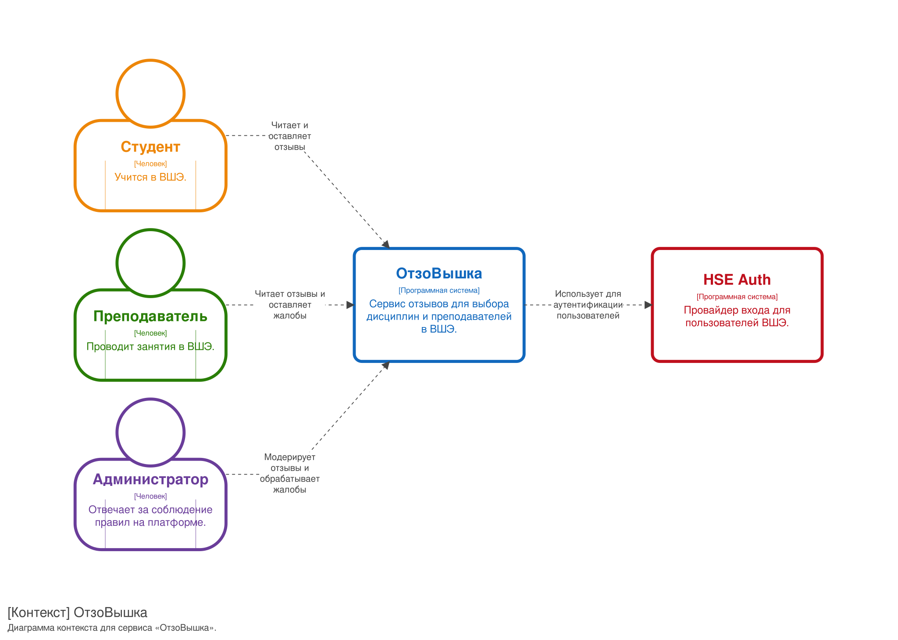
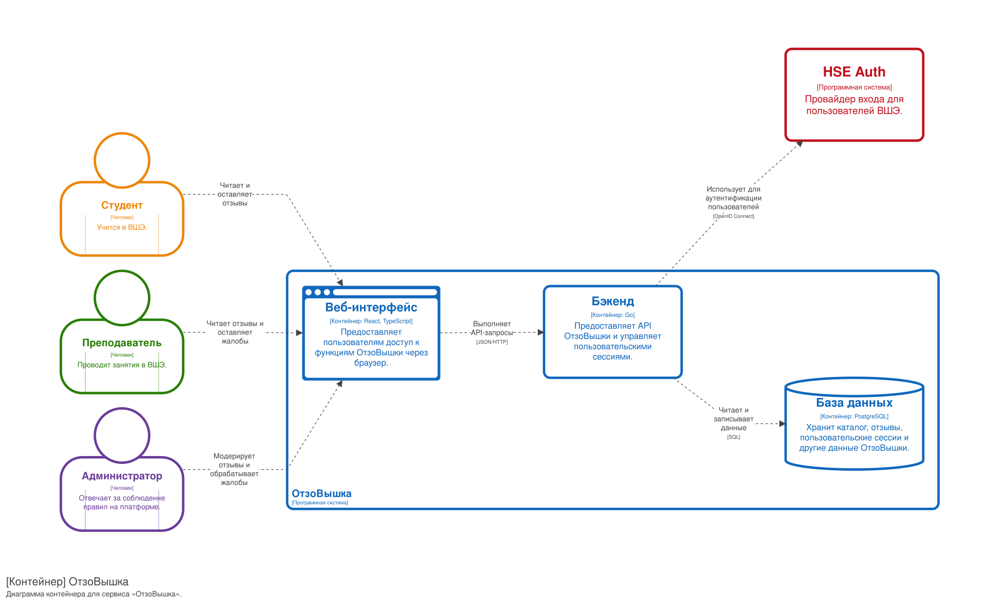

# Архитектура проекта

Модель C4 описана в файле [`workspace.dsl`](workspace.dsl).

## Контекст



## Контейнер



## Экспорт диаграмм в SVG

При запущенном Docker выполните команду из корня репозитория.

```sh
docker compose --file docs/c4/compose.yaml run --rm --no-TTY c4-export
```
